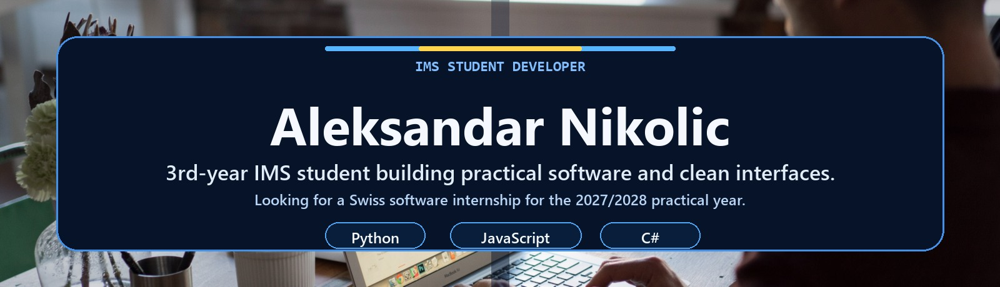

  
   
   
  <a href="https://aleksandar-nikolic.ch">Portfolio</a> |
  <a href="https://github.com/AleksZyro?tab=repositories">Repositories</a>
   
   
  

---

## About me

- Third-year IMS (Informatikmittelschule) student at Alte Kantonsschule Aarau and Berufsbildung Baden, specialising in application development since August 2026
- Looking for a one-year IMS internship in application development starting in August 2027 for the 2027/2028 academic year
- I build my own applications and tools, collaborate with friends on shared projects, and gain hands-on experience creating client websites
- I am particularly interested in clear user interfaces, reliable software, and cybersecurity

## Main projects

| Project | Description |
| --- | --- |
| [UMR – Useless Mobs Reworked](https://github.com/AleksZyro/UMR-Useless-mobs-reworked-Mod) | A Minecraft Forge mod that I develop with a friend, featuring new mob variants, AI behaviour, boss fights, models, and gameplay systems. One of my main projects, with development ongoing. |
| [FolioLint](https://github.com/AleksZyro/FolioLint) | A rule-based Python CLI for repeatable repository checks covering documentation, setup, tests, media, and readiness for public presentation. |
| [VSW](https://github.com/BotondCsereklye/VSW) | A collaborative full-stack web application built with FastAPI and React/TypeScript for defensive security checks, reports, exports, and scan history. |

<strong>More personal projects</strong>

| Project | Description |
| --- | --- |
| [PathLab](https://github.com/AleksZyro/PathLab) · [Demo](https://alekszyro.github.io/PathLab/) | An interactive React visualiser for BFS, DFS, Dijkstra, and A* on a weighted grid. |
| [SortLab](https://github.com/AleksZyro/SortLab) · [Demo](https://alekszyro.github.io/SortLab/) | Visualises and compares six sorting algorithms with custom inputs and operation counters. |
| [BESP2074](https://github.com/AleksZyro/BESP2074) | A personal Python simulation project with scenarios and an interactive map dashboard. |

## Client websites

- **[MM Transport & Assistance – mmta.ch](https://mmta.ch/):** A client website I am working on using Hostpoint, focusing on design, content, and implementing the client's requirements.
- **AARGO Clean GmbH:** Another client website is in progress; a detailed showcase will follow once it is complete.

## Open source

**Twelve merged pull requests in external open-source projects**, alongside contributions to my own and shared projects. Selected examples:

| Contribution | Change |
| --- | --- |
| [PyCQA/isort #2616](https://github.com/PyCQA/isort/pull/2616) | Preserved line endings for stdin/stdout on Windows and added regression tests. |
| [pypa/pip-audit #1119](https://github.com/pypa/pip-audit/pull/1119) | Prevented duplicate PYSEC vulnerability findings and added a test to cover the fix. |
| [tonym999/vault-cleaner #54](https://github.com/tonym999/vault-cleaner/pull/54) | Ensured the CLI respects configured input and output paths. |

[More contributions and supporting details in my portfolio](https://aleksandar-nikolic.ch/#github-activity)

<strong>School projects and hackathons</strong>

I have also gained experience through school projects and hackathons, including [Internet On and Off](https://github.com/BotondCsereklye/internet-ein-aus), [LB259](https://github.com/AleksZyro/LB259), [TwinType](https://github.com/AleksZyro/TwinType), and [PV Visual Placer](https://github.com/AleksZyro/PV-Visual-placer-).

For **Heimatschutz Aargau**, our team developed a proposed solution to the given requirements. We were one of three shortlisted teams; another team was selected to continue with implementation.

## Technologies and experience

Experience gained through personal projects, collaborative development, school, and client work, with varying depth depending on the project.

| Area | Technologies and context |
| --- | --- |
| Languages | Python, Java, JavaScript/TypeScript, C# |
| Web and APIs | HTML/CSS, React, Vite, FastAPI, ASP.NET Core |
| Data | SQL, SQLite, JSON/CSV, Jupyter Notebook |
| Development and testing | Git/GitHub, Docker, pytest, Vitest, GitHub Actions |
| Other tools | PowerShell, Streamlit, Ollama |
| Hosting and platforms | Netlify and a custom domain for my portfolio, Hostpoint for client websites, and AWS experience from school |

## Current focus

- Continuing development of UMR with a friend and improving existing tools and web applications
- Building and maintaining client websites
- Preparing applications and my portfolio for the 2027/2028 IMS internship

[Portfolio](https://aleksandar-nikolic.ch/) · [GitHub repositories](https://github.com/AleksZyro?tab=repositories)
