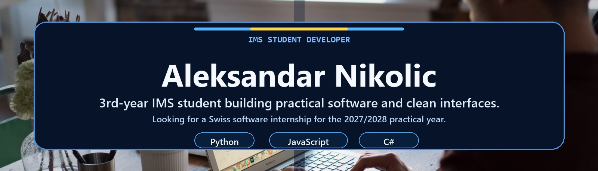

  
   
   
  <a href="https://aleksandar-nikolic.ch">Portfolio</a> |
  <a href="https://github.com/AleksZyro?tab=repositories">Repositories</a>
   
   
  
   
   
  

---

## Über mich

- IMS-Schüler an der Alten Kantonsschule Aarau und der Berufsbildung Baden, seit August 2026 im 3. Jahr mit Schwerpunkt Applikationsentwicklung
- Ich suche ein IMS-Praxisjahr in der Applikationsentwicklung ab August 2027 für das Schuljahr 2027/2028
- Ich entwickle eigene Anwendungen und Tools, arbeite mit Freunden an gemeinsamen Projekten und sammle Erfahrung mit Kundenwebsites
- Besonders interessieren mich verständliche Benutzeroberflächen, zuverlässige Software und Cyber Security

## Hauptprojekte

| Projekt | Kurzbeschreibung |
| --- | --- |
| [UMR – Useless Mobs Reworked](https://github.com/AleksZyro/UMR-Useless-mobs-reworked-Mod) | Minecraft-Forge-Mod, die wir zu zweit entwickeln: neue Mob-Varianten, KI-Verhalten, Bosskämpfe, Modelle und Gameplay-Systeme. Eines meiner Hauptprojekte, laufend in Entwicklung. |
| [FolioLint](https://github.com/AleksZyro/FolioLint) | Regelbasiertes Python-CLI für wiederholbare Repository-Checks: Dokumentation, Setup, Tests, Medien und öffentliche Präsentierbarkeit. |
| [VSW](https://github.com/BotondCsereklye/VSW) | Gemeinsame Fullstack-Webanwendung mit FastAPI und React/TypeScript für defensive Security-Checks, Reports, Export und Verlauf. |

<strong>Weitere persönliche Projekte</strong>

| Projekt | Kurzbeschreibung |
| --- | --- |
| [PathLab](https://github.com/AleksZyro/PathLab) · [Demo](https://alekszyro.github.io/PathLab/) | Interaktiver React-Visualizer für BFS, DFS, Dijkstra und A* auf einem gewichteten Raster. |
| [SortLab](https://github.com/AleksZyro/SortLab) · [Demo](https://alekszyro.github.io/SortLab/) | Visualisierung und Vergleich von sechs Sortieralgorithmen mit eigenen Eingaben und Operationszählern. |
| [BESP2074](https://github.com/AleksZyro/BESP2074) | Persönliches Simulationsprojekt mit Python, Szenarien und einem interaktiven Karten-Dashboard. |

## Kundenwebsites

- **[MM Transport & Assistance – mmta.ch](https://mmta.ch/):** Kundenwebsite, an der ich mit Hostpoint arbeite. Der Schwerpunkt liegt auf Gestaltung, Inhalten und der Umsetzung der Kundenwünsche.
- **AARGO Clean GmbH:** Eine weitere Kundenwebsite befindet sich in Arbeit; eine ausführliche Präsentation folgt nach Fertigstellung.

## Open Source

**Zwölf gemergte Pull Requests in externen Open-Source-Projekten**, zusätzlich zu Beiträgen an eigenen und gemeinsamen Projekten. Ausgewählte Beispiele:

| Beitrag | Änderung |
| --- | --- |
| [PyCQA/isort #2616](https://github.com/PyCQA/isort/pull/2616) | Zeilenenden bei stdin/stdout unter Windows erhalten und Regressionstests ergänzen. |
| [pypa/pip-audit #1119](https://github.com/pypa/pip-audit/pull/1119) | Doppelte PYSEC-Schwachstellenergebnisse vermeiden und die Korrektur mit einem Test absichern. |
| [tonym999/vault-cleaner #54](https://github.com/tonym999/vault-cleaner/pull/54) | Konfigurierte Ein- und Ausgabepfade in der CLI berücksichtigen. |

[Weitere Beiträge und Nachweise im Portfolio](https://aleksandar-nikolic.ch/#github-activity)

<strong>Schulprojekte und Hackathons</strong>

Weitere Erfahrung habe ich in Schul- und Hackathonprojekten gesammelt, darunter [Internet ein und aus](https://github.com/BotondCsereklye/internet-ein-aus), [LB259](https://github.com/AleksZyro/LB259), [TwinType](https://github.com/AleksZyro/TwinType) und [PV Visual Placer](https://github.com/AleksZyro/PV-Visual-placer-).

Für den **Heimatschutz Aargau** entwickelten wir im Team einen Lösungsvorschlag für die gestellten Anforderungen. Wir gehörten zu den drei Teams der engeren Auswahl; für die weitere Umsetzung wurde ein anderes Team ausgewählt.

## Technologien und Erfahrungen

Erfahrungen aus eigenen Projekten, gemeinsamer Entwicklung, Schule und Kundenarbeit – mit unterschiedlicher Vertiefung je nach Projekt.

| Bereich | Technologien und Kontext |
| --- | --- |
| Sprachen | Python, Java, JavaScript/TypeScript, C# |
| Web und APIs | HTML/CSS, React, Vite, FastAPI, ASP.NET Core |
| Daten | SQL, SQLite, JSON/CSV, Jupyter Notebook |
| Entwicklung und Tests | Git/GitHub, Docker, pytest, Vitest, GitHub Actions |
| Weitere Werkzeuge | PowerShell, Streamlit, Ollama |
| Hosting und Plattformen | Netlify und eigene Domain für mein Portfolio, Hostpoint für Kundenwebsites, AWS-Erfahrung aus der Schule |

## Aktueller Fokus

- UMR gemeinsam weiterentwickeln und bestehende Tools und Webanwendungen verbessern
- Kundenwebsites umsetzen und betreuen
- Bewerbungen und Portfolio für das IMS-Praxisjahr 2027/2028 vorbereiten

[Portfolio](https://aleksandar-nikolic.ch/) · [GitHub-Repositories](https://github.com/AleksZyro?tab=repositories)
